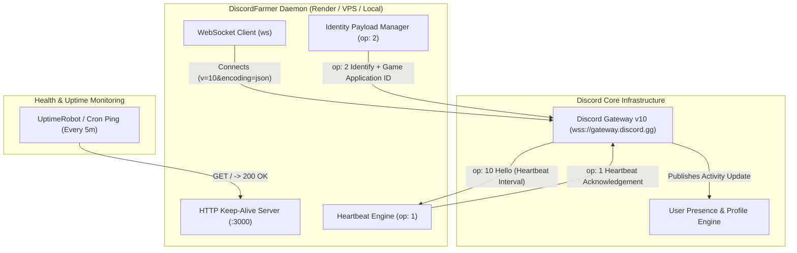

<div align="center">


[](https://nodejs.org/)
[](https://discord.com/developers/docs/topics/gateway)
[](https://github.com/websockets/ws)
[](https://render.com)
[](https://uptimerobot.com)
[](LICENSE)

<p align="center">
  <b>A lightweight, zero-footprint headless Node.js daemon that connects directly to the Discord Gateway v10 to simulate authentic, verified game presence 24/7 without running actual desktop games or heavy launchers.</b>
</p>

[Key Features](#-key-features) • [Architecture](#-architecture) • [Quick Start](#-quick-start) • [24/7 Cloud Deployment](#-247-cloud-deployment-render--vps) • [Game Presets](#-customizing-target-games) • [Security & Disclaimer](#-security--disclaimer)

---

</div>

## 📖 Overview

**DiscordFarmer** is a high-efficiency headless presence client developed in Node.js. Instead of running GPU-heavy games and wasting electricity, memory, and hardware lifespan on your local machine, **DiscordFarmer** directly connects to Discord's official **WebSocket Gateway API (v10)**.

It simulates active game sessions for verified titles (such as *Blood Strike*, *Brawlhalla*, *Counter-Strike 2*, and more), allowing your profile to continuously register playtime hours for Discord profile badges, community status, and playtime statistics.

```text
┌────────────────────────────────────────────────────────────────────────┐
│                        DISCORD PRESENCE CLIENT                         │
│  [STATUS] Online • [GAME] Blood Strike • [RUNTIME] 24/7 Cloud Active   │
└────────────────────────────────────────────────────────────────────────┘
```

---

## ✨ Key Features

- ⚡ **Zero Hardware Load:** No 3D engines, graphics cards, or game files needed. Runs on less than **25MB RAM** and **0.1% CPU**.
- 🎮 **Official Verified Game Metadata:** Sends official Discord Application IDs, ensuring genuine game banners, official icons, and rich metadata appear on your profile.
- 🔄 **Resilient Gateway v10 Heartbeat:** Automatically handles Discord Gateway Hello (`op: 10`), fires regular heartbeats (`op: 1`), and manages intelligent exponential backoff auto-reconnects on disconnection.
- 🌐 **Built-in HTTP Keep-Alive Server:** Native Node.js HTTP server on `PORT || 3000` answering with `200 OK` health checks, making it 100% compatible with free cloud providers (**Render**, **Koyeb**, **Railway**) and ping monitors (**UptimeRobot**, **BetterStack**).
- 🔐 **Zero Hardcoded Secrets:** Authenticates strictly via environment variables (`DISCORD_TOKEN`), preventing credential leaks in public source code.
- ⏱️ **Persistent Activity Timestamps:** Emits genuine Unix start timestamps (`timestamps.start`) so your Discord profile dynamically displays `Playing for X hours`.

---

## 🏗️ Architecture



---

## 🚀 Quick Start

### 1. Prerequisites
- **Node.js** (v18.0.0 or higher recommended)
- **Git** installed on your system
- A Discord User Token ([Guide below](#-how-to-obtain-your-discord-token))

### 2. Clone & Install
```bash
# Clone the repository
git clone https://github.com/thenudasahas2008/DiscordFarmer.git
cd DiscordFarmer

# Install dependencies (only 'ws' is required)
npm install
```

### 3. Configure Environment
Create a `.env` file in the root directory (or use `.env.example` as a template):
```env
DISCORD_TOKEN=your_discord_user_token_here
PORT=3000
```

### 4. Run the Client
```bash
# Using npm
npm start

# Or directly with Node.js
node game_farmer.js
```

---

## 🔑 How to Obtain Your Discord Token

> [!WARNING]
> **Never share your Discord token with anyone.** Anyone with your token has full access to your account. Do not upload or commit your `.env` file to any public repository.

1. Open **Discord** in your web browser (Google Chrome, Firefox, or Brave) at [discord.com/app](https://discord.com/app).
2. Log in to your Discord account.
3. Press <kbd>Ctrl</kbd> + <kbd>Shift</kbd> + <kbd>I</kbd> (or <kbd>F12</kbd>) to open **Developer Tools**.
4. Navigate to the **Network** tab.
5. In the filter box, type `/api` or `science`.
6. Click any request, scroll down to **Request Headers**, and locate the `authorization` header.
7. Copy the alphanumeric string value — that is your `DISCORD_TOKEN`.

---

## ☁️ 24/7 Cloud Deployment (Render & VPS)

### Option 1: Free 24/7 Hosting on Render (Recommended)

You can run this completely free on [Render](https://render.com) without a server:

1. Fork or push this repository to your GitHub account.
2. Log in to **Render Dashboard** and click **New +** → **Web Service**.
3. Connect your `DiscordFarmer` repository.
4. Configure the settings:
   - **Environment:** `Node`
   - **Build Command:** `npm install`
   - **Start Command:** `npm start`
   - **Instance Type:** `Free`
5. Under **Environment Variables**, add:
   - `DISCORD_TOKEN`: `Your Discord User Token`
   - `PORT`: `3000`
6. Click **Create Web Service**.
7. Once deployed, copy your Render application URL (e.g., `https://discord-farmer-xxxx.onrender.com`).
8. Create a free account on [UptimeRobot](https://uptimerobot.com):
   - Add **New Monitor** → Type: `HTTP(s)`
   - URL: `https://discord-farmer-xxxx.onrender.com`
   - Monitoring Interval: `Every 5 minutes`
   *(This triggers the built-in HTTP server and prevents Render free tier from sleeping).*

---

### Option 2: VPS / Linux Server (PM2 Daemon)

To keep it running in the background indefinitely on an Ubuntu / Debian VPS:

```bash
# Install PM2 process manager globally
npm install -g pm2

# Start DiscordFarmer under PM2
DISCORD_TOKEN="your_token_here" pm2 start game_farmer.js --name "discord-farmer"

# Configure PM2 to start on system boot
pm2 startup
pm2 save
```

Useful management commands:
```bash
pm2 logs discord-farmer   # View live heartbeat logs
pm2 restart discord-farmer# Restart service
pm2 stop discord-farmer   # Stop service
```

---

## 🎯 Customizing Target Games

To farm hours for a different game, simply update the `VERIFIED_GAME` object in [game_farmer.js](game_farmer.js):

```javascript
// Brawlhalla / Blood Strike / CS2 / Valorant Official Discord Verified Data
const VERIFIED_GAME = {
    name: "Blood Strike",                // Displayed Game Name
    application_id: "1183981646811254845", // Discord Verified Application ID
    type: 0                              // 0 = Playing
};
```

### Verified Game ID Database

| Game Title | Application ID | Category | Status |
| :--- | :--- | :--- | :--- |
| **Blood Strike** | `1183981646811254845` | FPS / Battle Royale | `Verified` |
| **Brawlhalla** | `356944273133928458` | Fighting / Platform | `Verified` |
| **Counter-Strike 2** | `884024345248100363` | Tactical FPS | `Verified` |
| **Valorant** | `700143425509982268` | Tactical Shooter | `Verified` |
| **Minecraft** | `432980957394370572` | Sandbox / Survival | `Verified` |
| **Grand Theft Auto V** | `356875221078245376` | Open World / Action | `Verified` |
| **Apex Legends** | `493173110799826944` | Battle Royale | `Verified` |
| **League of Legends** | `401518687463587841` | MOBA | `Verified` |

---

## 📁 Repository Structure

```text
DiscordFarmer/
├── .env.example       # Template environment configuration
├── .gitignore         # Ignores node_modules and secret environment files
├── game_farmer.js     # Gateway v10 WebSocket & Keep-alive HTTP server
├── package.json       # Node package manifest (ws engine)
└── README.md          # Comprehensive documentation & deployment guide
```

---

## 🛡️ Security & Disclaimer

> [!CAUTION]
> **Discord Terms of Service Notice:** Automating actions on user accounts (self-botting / gateway connection using user tokens) technically falls outside Discord's official Terms of Service. This software is created solely for personal educational research and game presence testing. Use it responsibly and at your own discretion. The author assumes no responsibility for any actions taken on your account.

- **Safe Farming Guidelines:**
  - Do not spam or flood Gateway connections (the built-in backoff protects against this).
  - Never commit your token to version control.
  - If you suspect your token has been compromised, simply change your Discord account password immediately to invalidate all existing tokens.

---

## 👨‍💻 Author & Maintainer

<div align="center">

**Thenuda Sahas Sooriyaarachchi**  
*Cybersecurity Researcher • DFIR Analyst • Ethical Developer*

[](mailto:sahas.thenu@gmail.com)
[](https://github.com/thenudasahas2008)
[](https://thenudasahas.site/)
[](https://discord.com)

<p align="center">
  <sub>⭐ If you find this project useful, don't forget to star the repository! ⭐</sub>
</p>

</div>
